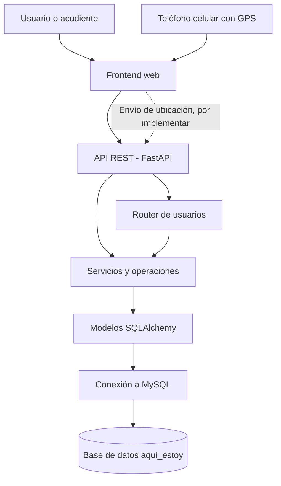

# Arquitectura del sistema — AQUÍ ESTOY

## 1. Descripción general

AQUÍ ESTOY es un sistema de geolocalización orientado al monitoreo y cuidado de niños y adultos mayores. Su propósito es permitir que un acudiente o familiar autorizado consulte la ubicación de una persona monitoreada, establezca zonas seguras y reciba alertas ante situaciones de riesgo.

El proyecto contempla el uso de un teléfono celular como fuente de ubicación GPS durante la primera versión funcional (MVP). La integración con una pulsera o dispositivo GPS dedicado se considera una posibilidad futura.

La arquitectura propuesta utiliza una aplicación web, una API desarrollada con FastAPI y una base de datos MySQL.

## 2. Arquitectura tecnológica

### Frontend

Tecnologías identificadas en el proyecto:

- HTML5 para la estructura de las páginas.
- CSS3 para los estilos y la presentación visual.
- JavaScript, si se incorpora o utiliza en las páginas, para la interacción con la API y la gestión de la geolocalización.

Responsabilidades:

- Presentar las interfaces del sistema.
- Permitir el ingreso y la visualización de información.
- Facilitar la consulta de ubicaciones y alertas.
- Solicitar permisos de geolocalización al dispositivo cuando corresponda.

### Backend

Tecnologías identificadas:

- Python.
- FastAPI para la construcción de la API REST.
- SQLAlchemy para la interacción con la base de datos.
- Pydantic para la validación de datos.
- Uvicorn como servidor ASGI de desarrollo.
- `pwdlib` para el procesamiento seguro de contraseñas en la lógica existente de creación de usuarios.

Responsabilidades:

- Recibir y validar solicitudes del frontend.
- Ejecutar las operaciones de negocio.
- Consultar y modificar los datos autorizados.
- Gestionar usuarios y, progresivamente, las funcionalidades de geolocalización.
- Responder mediante formatos JSON.

### Base de datos

Motor: MySQL.

Base de datos: `aqui_estoy`.

Responsabilidades:

- Almacenar la información de los usuarios.
- Registrar los dispositivos asociados al sistema.
- Almacenar las ubicaciones recibidas.
- Gestionar las zonas seguras, las notificaciones y la información de suscripciones y pagos, de acuerdo con el esquema implementado.

La estructura real de la base de datos debe verificarse antes de modificar los modelos o ejecutar cambios en las tablas.

## 3. Diagrama general de arquitectura



El teléfono celular podrá actuar como fuente de coordenadas GPS. El frontend deberá obtener la ubicación con los permisos correspondientes y enviarla al backend para su validación y almacenamiento.

El flujo de geolocalización descrito es parte de la arquitectura prevista; no implica que dicha funcionalidad ya esté implementada.

## 4. Estructura del proyecto

```text
Aqui_estoy/
├── backend/
│   ├── database/
│   │   └── conexion.py
│   ├── models/
│   │   ├── operaciones.py
│   │   └── usuario.py
│   ├── routers/
│   │   └── usuarios.py
│   ├── schema/
│   │   └── usuario.py
│   ├── main.py
│   ├── probar_conexion.py
│   └── .env
├── db/
│   ├── aqui_estoy.sql
│   └── aqui_estoy_diagrama.mwb
└── frontend/
    ├── index.html
    ├── inicio_sesion.html
    ├── nuevo_usuario.html
    ├── recuperar_contraseña.html
    └── css/
```

La estructura anterior representa los archivos identificados en el proyecto. Pueden existir otros archivos o directorios adicionales.

### Responsabilidad de cada componente

| Archivo o carpeta | Responsabilidad |
|---|---|
| `backend/main.py` | Crear la aplicación FastAPI e incluir los routers. |
| `backend/database/conexion.py` | Configurar la conexión con MySQL y las sesiones de SQLAlchemy. |
| `backend/models/usuario.py` | Definir el modelo de usuario mediante SQLAlchemy. |
| `backend/models/operaciones.py` | Contener operaciones de acceso y modificación de usuarios. |
| `backend/routers/usuarios.py` | Definir los endpoints relacionados con usuarios. |
| `backend/schema/usuario.py` | Validar los datos de entrada y salida mediante Pydantic. |
| `backend/probar_conexion.py` | Comprobar la conexión con la base de datos. |
| `db/aqui_estoy.sql` | Contener una exportación SQL del esquema de la base de datos. |
| `db/aqui_estoy_diagrama.mwb` | Contener el modelo de base de datos de MySQL Workbench. |
| `frontend/` | Contener las páginas y los recursos de la interfaz web. |

## 5. Flujo actual de creación de usuarios

El backend incluye un endpoint para crear usuarios.

Flujo general:

1. El cliente envía los datos del usuario a la API.
2. FastAPI recibe la solicitud en el router de usuarios.
3. El esquema Pydantic valida los datos recibidos.
4. La lógica de operaciones procesa la información y genera el hash de la contraseña.
5. SQLAlchemy ejecuta la operación correspondiente en MySQL.
6. La API responde con los datos permitidos del usuario creado o con un error controlado.

Endpoint identificado:

`POST /usuarios/`

El endpoint debe probarse en el entorno local para confirmar que funciona correctamente con el esquema real de la base de datos.

## 6. Funcionalidades previstas para el MVP

Las siguientes funcionalidades representan el alcance propuesto para la primera versión funcional:

- Registro y gestión básica de usuarios.
- Asociación entre el acudiente, la persona monitoreada y el dispositivo.
- Captura de coordenadas desde un teléfono celular.
- Envío y almacenamiento de ubicaciones.
- Consulta de la última ubicación disponible.
- Creación y consulta de zonas seguras.
- Generación de alertas por salida de una zona segura o pérdida de comunicación.
- Consulta del historial de ubicaciones de las últimas 72 horas.

Estas funcionalidades deben implementarse y probarse antes de considerarlas terminadas.

## 7. Seguridad

La arquitectura debe contemplar las siguientes medidas:

- Almacenar contraseñas mediante algoritmos de hash seguros, nunca en texto plano.
- Validar los datos recibidos por la API.
- Proteger los endpoints que consulten información privada.
- Permitir el acceso a ubicaciones únicamente a usuarios autorizados.
- Evitar publicar credenciales o archivos `.env` en repositorios públicos.
- Utilizar HTTPS en ambientes desplegados.
- Registrar los errores sin exponer contraseñas, tokens ni otros datos sensibles.
- Solicitar los permisos y autorizaciones necesarios para el tratamiento de datos de ubicación.

## 8. Ejecución local del backend

Desde la carpeta `backend`, ejecutar:

```bash
python -m uvicorn main:app --reload
```

Si el servidor inicia correctamente, la API estará disponible normalmente en:

`http://127.0.0.1:8000`

La documentación interactiva de FastAPI se encuentra en:

`http://127.0.0.1:8000/docs`

Estos enlaces corresponden al entorno local de desarrollo.

## 9. Consideraciones pendientes

Antes de continuar con el desarrollo, se debe:

1. Comparar los modelos SQLAlchemy con las tablas reales de MySQL.
2. Confirmar que todos los campos definidos en el modelo `Usuario` existen en la tabla `usuarios`.
3. Verificar la conexión y el funcionamiento del endpoint de creación de usuarios.
4. Implementar los endpoints de dispositivos y ubicaciones.
5. Conectar las páginas del frontend con la API.
6. Implementar y probar la autorización para consultar ubicaciones.
7. Validar el almacenamiento y la consulta del historial de ubicaciones.

La arquitectura debe evolucionar de manera incremental, conservando el código funcional y realizando cambios controlados y verificables.
